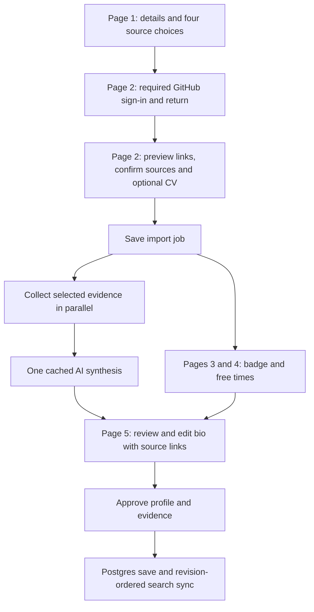

# Profile enrichment: shared delivery brief

Status: user journey and four independent source permissions confirmed; API remains a proposal. Feature code has not started. Owner: Person B. Updated: 7 November 2026, America/Denver.

This is the shared context for the user's separate Codex and Claude sessions. Read it together with `AGENTS.md`, `docs/Build-Plan.md` and `docs/Quality-Gates.md`. The user requested frontend and backend delivery of the complete bounded feature below. Existing folder ownership and approval rules still apply. This document proposes the API; it does not freeze or approve a contract change by itself.

## 1. What we are building

The user first enters their basic details and chooses permitted sources. On page two they sign in with GitHub, preview possible research/public-profile matches, confirm the links that belong to them, optionally upload a CV, and can turn sources off again. Continuing starts collection and synthesis while they finish badge and availability choices. The user reviews and edits the resulting evidence-backed bio before it replaces their public profile.

Confirmed decisions from the user: Public/university profile is a separate fourth source permission. GitHub authentication remains mandatory even when GitHub data import is off. This details-first, source-confirmation-second flow supersedes the earlier sign-in-first recommendation in this document. Do not move authorization ahead of page one or combine public-profile permission with Research/CV.

Four optional data sources ship together:

| Source | First-release behavior |
| --- | --- |
| GitHub | Existing public bio/repository/language/organisation permissions. GitHub authenticates every user on page two; importing its optional data happens only when still selected at final source confirmation. |
| Research | OpenAlex API; prefer an optional ORCID, otherwise search using confirmed name and workplace/ROR. Show up to four author candidates with affiliations, sample papers and clickable links; require a selection or Skip. Import up to ten papers from the selected author. |
| Public professional profile | Use a supported search API to find candidates from name and workplace. Show **at most four** deduplicated candidates with title, visible domain, plain-text snippet and clickable HTTPS URL. Select one, choose None of these, or provide a URL. Fetch the chosen page only. |
| CV | One text-based PDF or DOCX, at most 2 MiB. Extract plain text, show filename/result/warnings, and allow replacement/removal. Support pasting CV text as the fallback for scans or unreadable files. |

Interpretation of the user's four-profile limit: four search candidates, with **one confirmed public-profile page per run**, initially unselected. An external link opens the actual page in a new tab with `noopener noreferrer`; opening it does not select it. Search results are suggestions, not verified identities. No result is selected automatically.

Scanned PDFs requiring OCR, encrypted documents, old `.doc` files, private/login-only pages, LinkedIn scraping, recursive website crawling and arbitrary file downloads are outside this release. CV and LinkedIn must no longer be presented as one working capability: label the working option CV upload, with LinkedIn import remaining separate. Optional ask sharpening, five-minute meetings, ask lists and changed blocker defaults are separate proposals; do not bundle them here.

## 2. Current code and coordination baseline

- `origin/main` was `dde538d` when this brief was written; #41 is merged. Local `D:\Projects\Convo` is an old checkout, so start feature branches from freshly fetched `origin/main`, not its local HEAD.
- #44 is still under changes requested, but its head moved to `d3ca4a1` during planning. Re-review that latest head before treating old findings as still unfixed. The requested fixes are separate: last-person focus, retaining all failed-pass locks, the all-passed empty state, and genuine pointer tests for mobile switches. Claude addresses any remaining findings before taking ownership of the new screen branch; do not redo fixes already present.
- #45 (`a1/feedback-round-4`) is also open and depends on #44, changing Back navigation and badge controls. Coordinate with that existing frontend session before editing the same files. Merge/review or explicitly freeze this work, then start the enrichment screen branch from the agreed updated main. Neither PR is declared merge-ready by this planning document.
- `src/server/profile/github.ts` imports the consented public metadata. `buildProfile()` currently copies the existing GitHub bio; it does not write one with AI.
- `initializeGitHubProfile()` currently imports and saves GitHub evidence in the sign-in callback, preserving edits on repeated sign-in. With the feature enabled, separate minimal identity persistence from optional imports: authenticate and return to page two first, then collect GitHub source data only after the user's final Continue. Optional import failure must not deny authentication. Keep the legacy flow when the feature is off. Do not put discovery, CV parsing or AI synthesis into the authentication callback.
- `syncProfile()` currently accepts only up to 20 repo evidence records from `users.githubEvidence`. Merely adding papers to that column will fail validation. General evidence storage, validation, sign-in preservation, pending filtering and rebuild recovery all need updating together.
- Existing `users.revision` protects search ordering. `scripts/seed.ts` already replays real users through `syncProfile(user, elasticSearch)`; retain that path and test it with every new source.
- Existing `Person.languages` means programming languages. Add a separate bounded `expertise` field for professional/research topics; do not put research subjects into `languages`.
- Search reserves the internal kind `profile` for its generated profile document. Use a different evidence kind, such as `profile_page`, for a collected page. Existing `paper` can represent publications; a new `cv` kind represents only user-approved professional excerpts.

## 3. User journey

1. **Page one — About you and source choices:** name, workplace/ROR and country, with optional ORCID. Four independent import controls: GitHub, Research, University/public profile and CV. Keep granular GitHub bio/repository/organisation choices. Explain AI processing of selected information. Source permissions are optional; authentication is not. Preserve this unsaved draft across the GitHub round trip without making provider requests before authorization.
2. **Page two — Connect and confirm:** show Continue with GitHub when authentication is needed, even if GitHub import is off. Return to this same page after OAuth, retaining page-one answers and choices. Only then discover selected sources and allow uploads. Show up to four research-author candidates and separately up to four public-profile candidates, with clickable links and enough preview information to identify them. Choose one from each list, None of these, Skip, or a permitted manual fallback. Opening a link is separate from selecting it. A failed lookup is not presented as zero matches. Source controls remain editable here: turning one off clears its candidate selection/input and excludes it from collection/AI. CV can be uploaded, replaced or removed on this page. Final Continue snapshots the chosen permissions, links and CV, saves the job, and starts import/synthesis. If all sources are off, continue to a manual profile without an AI call.
3. **Page three — Badge:** hiring answer, badge colour and visibility; preserve country/workplace from page one. Background collection and synthesis continue. Show per-source progress without blocking these choices.
4. **Page four — Availability:** free-time entry while enrichment continues. A small progress indicator follows the persisted job. Poll only while relevant; stop on terminal states or navigation.
5. **Page five — Review and approve bio:** show the proposed bio and expertise, confirmed source links, evidence selection and incomplete-source warnings. Allow editing, removing wrongly attributed evidence, retry and manual continuation. If the job is not finished, show actual progress; completion by this page is a target, not a guarantee. Approval saves only accepted fields/evidence, preserving current onboarding choices and newer edits. Never silently publish. A signed-in returning user can keep their approved profile and skip enrichment.



## 4. Concrete implementation proposal

### Discovery and retrieval

- Research and public-page discovery are separate choices and separate result lists, each capped at four candidates. Reconfirm candidates if page-one identity/workplace changes. No data is scraped from an unselected candidate, and changing a source to off invalidates in-flight results and removes its unaccepted input. A UI toggle never signs the user out of GitHub.
- Source jobs obtain any required GitHub credential server-side from the existing encrypted auth session; never expose it through the public session, source API, job table, cache or logs. Do not persist a new plaintext token store. A retry without a valid provider credential asks the user to reconnect, then returns to page two with their safe selections intact.
- Use OpenAlex's current API, with a server-only `OPENALEX_API_KEY`. Resolve institution IDs from ROR when available. ORCID and name/affiliation signals help locate candidates but do not replace user confirmation or prove account ownership. Affiliation history is not automatically the current workplace.
- Proposed public-web discovery provider: Brave Web Search, with server-only `BRAVE_SEARCH_API_KEY`. Use a bounded name/workplace query, prefer the confirmed organisation's domain, deduplicate canonical URLs, and return at most four eligible results. Provider failure returns an unavailable status and manual URL fallback. Do not scrape Google search HTML or treat a search snippet as biographical evidence.
- Show a candidate ID in the API, not a trusted client-supplied copy of search text. Bind the saved candidate set to the signed-in owner and input fingerprint; reject stale candidate IDs after name/workplace changes. Revalidate the chosen URL at fetch time.
- Public-page fetching accepts HTTPS only and no credentials. Block non-public IPv4/IPv6 destinations and metadata endpoints; check resolution and each redirect with connection-time protection against DNS rebinding. Limit redirects, body size, content type and time. A URL regex or initial DNS check alone is insufficient. Do not run page scripts or fetch embedded assets. Keep one bounded page and strip navigation/scripts before extracting professional text. Respect site access restrictions and offer paste-text when unavailable.
- Bound each source independently. Proposed caps: 20 repositories, ten papers, one 1 MiB HTML page, one 2 MiB CV, 30,000 extracted CV characters, and five approved CV evidence excerpts. No unbounded pagination or model calls inside item loops. Deduplicate papers by DOI or OpenAlex ID, not title alone.

### CV processing and private data

- Verify actual format and size, not just extension or MIME. For PDFs, cap pages before extraction (proposed 20), disable external resource fetching, and enforce memory/CPU limits. For DOCX, validate the ZIP/container, cap entries and total expanded bytes, reject encrypted/malformed archives, and keep external file access disabled.
- Proposed text parsers: `unpdf` for PDF and `mammoth.extractRawText` for DOCX. Neither is installed today. These dependencies are justified by real document parsing; do not write a PDF/Office parser or render converted HTML. Pin compatible versions during implementation and test them in the deployed Node runtime. Use killable parsing isolation for hard limits; `Promise.race()` alone cannot stop CPU-bound parsing.
- Parse within the authenticated upload operation; discard original bytes after extraction. Persist the bounded extracted input privately in Postgres for synthesis/retry, never in a public blob or a public download URL. Apply ownership checks to every upload/job read and write. No browser-stored CV body or raw-text logging.
- Show that professional CV information can become public through the approved bio/evidence. Exclude phone numbers, email/contact addresses, referees and unrelated sensitive information from model input and public output. Retain only reviewed professional excerpts for matching; the original CV and full extracted input are not searchable evidence.
- Remove temporary CV text when accepted, cancelled, replaced or explicitly removed. Unfinished input expires after 24 hours and cannot be read/used after expiry. Add an authenticated daily cleanup job to physically purge expired input; state its cleanup window honestly, with a proposed target within 48 hours. Verify cron timing on the actual Vercel plan before promising that window. Missing cleanup setup blocks enabling CV in production.
- Expiry also invalidates unaccepted CV-derived drafts/cache entries; require re-upload or removal of that source before approval. Already approved, explicitly selected professional excerpts remain until the user removes their CV source. They are distinct from the full temporary extraction.

### Background work, cost and recovery

- Pilot execution proposal: Postgres job state plus bounded Next.js `after()` work, reusing the existing platform rather than introducing a queue account. Save before scheduling; claim work atomically with a lease so duplicate requests cannot start duplicate synthesis. Give the handler a documented, supported time budget and per-source deadlines.
- `after()` is bounded by the platform's function duration; it is not a durable queue. An interrupted job remains recoverable in Postgres. Status reports a stale lease as stalled, and a deliberate retry POST resumes it. Do not promise automatic completion/retries after a process dies while the user is away. Use a durable queue later if unattended guaranteed retries become required.
- Use one batched synthesis per confirmed source snapshot. Cache by owner, canonical evidence hash, consent/selection generation, model and prompt version. Extend the existing `ai_cache.kind` type for profile synthesis, and make private enrichment cache entries owner-scoped with explicit cleanup; do not place raw CV prompts in the cache key or logs. Cache only validated output and referenced source IDs, with removal on source withdrawal.
- Reuse the installed OpenAI SDK and the existing schema-validation approach in a B2-owned `src/server/profile/enrichment/synthesis.ts`. Leave B1's ask-refinement/explanation implementation unchanged. Limit per-user discovery, upload, start and retry attempts in shared durable storage; do not rely on a per-instance map.
- Expose partial results honestly. One optional provider failure must not deny sign-in or discard successful sources. A draft made with missing sources needs a visible warning before approval. An empty/failed import offers manual editing.

### Import failure messages and help block

The user requested instructions for allowing an import when access is blocked. Show a source-specific expandable **How to fix this** block beside the affected source, based on a sanitized backend reason code. Do not display provider error bodies. Do not claim that a profile is private or blocks access without evidence; a 403 can also mean rate limiting, and missing data can be a valid result.

| Known result | User-facing meaning and action |
| --- | --- |
| Import source off | Not selected / Not imported. Enable that source and its desired subchoices to include it. This is not a failure; keep GitHub sign-in active. |
| GitHub sign-in cancelled/not completed | GitHub sign-in is required to continue. Offer Continue with GitHub again and preserve page-one details; optional data imports may stay off. |
| Selected source permission off in Lanyard | Show which import choice is disabled and where to enable it. Never broaden requested OAuth scopes automatically. |
| GitHub credential revoked/expired, or confirmed authorization failure | Offer Reconnect GitHub. Explain GitHub Settings > Applications > Authorized OAuth Apps as the place to inspect the app's access. Use the app's actual OAuth registration name, which may still be Convo. Do not tell users to revoke unrelated apps. |
| No public GitHub bio/repos/organisations returned | Say no public information was found for that category. Let users use another source or manual bio. Public organisation membership can be checked using GitHub's documented visibility controls; changing privacy remains optional. Do not call an empty public list a permission failure or request private-repository access. |
| OpenAlex has no confident match | Offer name/workplace correction, ORCID, another candidate or Skip. Do not say the researcher denied access. |
| Selected public page requires login or denies retrieval | Say that this page cannot be imported automatically. Offer another public URL or pasted professional text. Do not bypass a login/access restriction. |
| Provider rate limit, outage or timeout | Say temporarily unavailable, preserve successful selections and show Retry with any supported cooldown. Do not direct the user to change profile privacy. |
| Unreadable/encrypted/scanned CV or invalid format | Explain the specific supported format/size issue and offer a text-based PDF/DOCX or pasted text; keep other sources working. |
| Unknown cause | Import unavailable; offer Retry, another source or manual continuation. Do not guess that profile settings caused it. |

Authentication and import status must remain distinct in the API and UI: signed in can coexist with GitHub import off, empty, failed or requiring reconnect. Only failed identity authentication or failure to save the minimal account can block sign-in. Optional-source permission/import failures cannot.

### Evidence, approval and concurrent changes

- Keep collected inputs, generated drafts and the approved public profile distinct. Evidence has an owner, source kind, stable external ID, source URL where public, retrieval time, consent generation and bounded text. IDs must include owner/source namespaces to avoid collisions.
- Add general durable evidence alongside legacy GitHub storage and backfill existing records without drops or resets. A transitional nullable general snapshot distinguishes not-migrated from intentionally empty; never use an empty-array length test to fall back to withdrawn GitHub evidence.
- `syncProfile()` indexes the complete approved evidence snapshot, preserves revision ordering and clears its pending state only for that exact revision. Update every B2 reader of the old GitHub-only pending flag, including matching exclusions. A rebuild/seed must restore all approved sources and expertise.
- A repeated GitHub sign-in updates only that source's imported snapshot. It must not erase accepted papers, CV excerpts, public-page evidence or the user's edited bio. A newly collected source snapshot becomes a proposed update; do not silently replace an accepted profile while it processes.
- With enrichment enabled, stage newly imported GitHub evidence for review rather than marking an otherwise current accepted profile pending merely because a draft changed. Source withdrawal is the exception: remove its searchable evidence immediately and expose any unconfirmed synchronization honestly.
- Give bio/expertise a separate text-edit revision, in addition to the general search revision. A job records the text revision it started from. Country/availability/colour changes during onboarding are expected and must not make every draft stale. A newer bio/expertise edit makes acceptance return 409 for review/regeneration; never overwrite it with an old draft. Acceptance patches only the chosen fields, increments the general revision and synchronizes the latest full profile.
- Every commit checks the current consent/selection generation. Source removal cancels or invalidates old work and removes that source's evidence, private extracted inputs and cached drafts. Repair the search copy with a newer revision. Do not resurrect removed evidence through a late worker. Flag derived bio claims for user review rather than blindly deleting their hand-written text.
- AI receives external text as untrusted data, without tools or credentials. Output includes a two/three-sentence bio (at most 600 characters), at most eight expertise labels (60 characters each) and supporting evidence IDs. Validate the shape, ownership and references; those checks do not establish truth, so preserve human review. Do not infer expert/maintainer/current-employment claims from a repo language, coauthorship or old affiliation alone.
- Country, workplace and hiring keep their existing display controls. Prevent generated public bio text from automatically reintroducing facts the user hid. Keep private visibility settings, CV contents and unsupported/sensitive claims out of cards and diagnostics.

## 5. Proposed shared API (Codex writes; Claude reviews before implementation)

Exact schemas, bounds, error codes and fake/real parity must be agreed and committed in the foundation PR. Route names below are the proposed interface, not endpoints that exist today.

| Route | Request | Response / behavior |
| --- | --- | --- |
| `POST /api/profile-enrichment/discover` | Authenticated page-two request: page-one name/workplace/ROR, optional ORCID, explicitly selected discovery sources | Owner-bound `discoveryId`, at most four authors and four public pages, per-source `ok/no_matches/unavailable/not_selected`, safe warnings/reason codes. Each public candidate has `id/title/url/domain/snippet`. No scraping of candidate pages yet. |
| `POST /api/profile-enrichment/cv` | Authenticated multipart request with one permitted file and explicit upload consent | Owner-bound `uploadId`, filename, extracted-character count, warnings and expiry. Binary and raw extracted text do not appear in the response. |
| `POST /api/profile-enrichment` | Discovery ID and selected author/page IDs, optional validated manual URL, CV upload ID, source permissions and client-generated idempotency key | `jobId`, state, selection generation. No client-selected user ID; repeated starts with the same key return the same job. All source IDs are checked against the owner and current selections. |
| `GET /api/profile-enrichment/:id` | Job ID | State/phase, per-source progress, sanitized reason/help codes and supported retry cooldown, and owner-only draft/evidence when ready; draft/text versions and whether approval needs refreshed review. Never raw credentials or full CV input. |
| `POST /api/profile-enrichment/:id/retry` | Job ID and permitted retry/source choice | Same job or a new draft version, with atomic lease ownership. No duplicate work, and no forced retry while a valid lease is running. |
| `POST /api/profile-enrichment/:id/accept` | Expected draft and base text versions, edited bio/expertise, selected evidence IDs | Latest saved `Person` and synchronization result. Stale edits/consent are 409; a committed save with unconfirmed indexing returns a structured retryable outcome carrying the saved identity/version, not an ID hidden in error text. Repeat acceptance is safe. |
| `POST /api/profile-enrichment/:id/cancel` | Job ID | Confirmed cancellation and removal of temporary private input; late work cannot publish. |
| `POST /api/profile-enrichment/sources/:id/remove` | Owner-bound source ID | Persisted withdrawal and explicit search-sync result. Repeat removal is safe. |

The operational CV cleanup endpoint is authenticated with `CRON_SECRET` and outside the screen contract, like `/api/health`. It returns counts only. Its scheduler must be configured before production CV is enabled.

- Extend `Person`/`CardPerson` with optional bounded `expertise` (default to an empty list for older data), and `EvidenceKind` with the needed page/CV kinds. Preserve the meaning of `languages` and the existing `MatchResult`/request routes.
- Add all screen endpoints to `routes.ts`, update the fake and `contract.test.ts` in the same PR, and cover the real route adapters with recorded providers. Every new route respects `FAKE_API=1`; it never contacts a provider in fake mode. Read application switches only in `src/server/config.ts`.
- The existing `api()` wrapper reads JSON bodies. The multipart route needs an explicit contract and a thin multipart adapter that performs the same authentication, fake/real dispatch and schema checks. Do not pretend the JSON wrapper accepts files; agree any shared-helper changes in the foundation PR.
- All endpoints are authenticated and owner-scoped. Cap strings, arrays, file counts and source URLs at the trust boundary. Distinguish 400/413/415/422 invalid input, 401/404 ownership, 409 stale/running work, 429 user limits and sanitized retryable provider/storage failures.
- Discovery, upload and job/status endpoints must work before onboarding filters are complete. Read the authenticated identity/owner record rather than calling `getProfile()`, which currently returns 409 while filters are null. Index the accepted profile only once its required onboarding fields are complete.

## 6. Work split: two external sessions, one writer per file

| Work | Codex | Claude |
| --- | --- | --- |
| Existing #44/#45 | Review their latest pushed changes; no competing screen edits | Verify #44's latest fixes and #45's dependent changes with the existing frontend owner, finish remaining findings/regressions, and signal READY FOR PERSON B REVIEW |
| Shared foundation | Sole writer of schemas, route definitions, fake/fixtures/contract tests; proposed config, dependency and deployment files | Review request/response semantics and UI feasibility; do not edit the same shared files |
| Backend | B2: `src/server/profile/`, auth, requests' pending filters, `src/server/real.ts`, `src/app/api/`, `db/`; profile synthesis stays in this B2 service | Consume the agreed endpoints; no B2 edits |
| Frontend | Review behavior/contracts; no competing screen changes | A1/A2 folders and `src/components/ui/`, `tests/e2e/`: page-one details/permissions; page-two mandatory GitHub authorization, candidate previews/selection, source toggles, help blocks and CV; badge, availability, progress, review/editor and expertise display |
| Search compatibility | Provide the accepted full Person/evidence snapshot via the existing ingest interface | B1: add expertise to Elastic/in-memory profile matching and synthetic defaults where necessary, and prove seed/rebuild restores all accepted sources. Keep this a separate small B1 PR; coordinate schema assumptions with Codex |

The user has two separate accounts/sessions; do not assume messages or files in one agent's memory are visible to the other. The repository document, agreed contract commit and PR descriptions are the shared record. This brief does not spawn agents or send messages to Claude automatically.

Root/shared files such as `package.json`, `package-lock.json`, `.env.example`, `vercel.json` and `src/server/config.ts` have one writer, Codex, for this feature. Obtain the required owner approval in the shared foundation PR for any ownership exception; do not silently edit an unowned file. Both people approve contract changes. No standing exception to AGENTS.md is created by a branch name.

Keep Person A's other agent from editing these same screen files while the assigned Claude session owns them. A can review. Use separate worktrees for Codex and Claude; never have both switch branches in the same checkout.

## 7. PR and release order

1. **Review this brief and settle #44/#45 separately.** Codex can prepare the contract/fake while Claude coordinates the existing frontend PRs and reviews the proposal. Record any agreed change to this document before either implements against a different shape. Do not run two frontend sessions against the same files.
2. **Foundation PR:** `b2/profile-enrichment-contract`. Prepare the shared schemas/fake/tests, explicit multipart behavior, feature flag/capability handling and agreed dependencies/setup locally. Signal ready and obtain the user's permission to open the PR, as previously requested. Both people approve and the user merges. Keep production behavior unchanged with the new feature disabled.
3. From that exact updated main commit, work in parallel: Codex `b2/profile-enrichment-backend`; Claude `a1/profile-enrichment`. Claude uses the fake immediately. Backend services have recorded-provider tests. No agent edits the other's files to work around an API problem; raise a concrete contract proposal.
4. Claude's separate B1 compatibility PR, `b1/profile-enrichment-search`, uses the agreed types and existing `syncProfile` entry point. Backend and B1 maintain compatibility while the new feature flag is off. Confirm actual dependencies before choosing the merge order; no import may point at a function available only in an unmerged branch.
5. Integrate all three branches in an isolated checkout. Review and test twice, fixing the first round's findings and checking the second for regressions. Retest against the updated main after other merges. The user merges reviewed PRs individually using Create a merge commit. Retarget stacked PRs to main and push a commit for Sonar; no branch bypasses the four gates.
6. Enable the complete feature for a controlled pilot only after all components, migration, provider configuration, cleanup and manual acceptance pass. One product release can consist of several small PRs behind one flag; do not release working-looking controls backed by stubs.

Proposed flag: `PROFILE_ENRICHMENT_ENABLED=0` until release, read only by central config and passed as a server-provided screen capability. An older enabled draft must not bypass a later disabled capability. Keep existing GitHub-only onboarding available while the flag is off. Do not change `FAKE_API`/`FAKES` or other production settings automatically.

## 8. Setup the user performs manually

No keys are needed to agree schemas or build the fake. Before live acceptance:

1. OpenAlex: create an API key and set server-only `OPENALEX_API_KEY` locally and in the intended Vercel environment. Confirm current usage limits in its dashboard.
2. Brave Web Search: create a compatible API key/subscription and set server-only `BRAVE_SEARCH_API_KEY`. Confirm allowed display/retention of search results; use it for candidate discovery and retain only the selected actual source page as evidence.
3. Reuse existing GitHub OAuth, OpenAI, Neon, Elasticsearch and Dash0 settings. No new blob account is proposed because original CV files are discarded after parsing.
4. Generate `CRON_SECRET` privately; configure the authenticated daily expired-input cleanup in `vercel.json`, verify its deployment schedule, and verify the deletion window. Never paste keys or secrets into chat, screenshots or PR bodies.
5. Apply the reviewed additive/backfill migration to the intended Neon database. Existing user data and migrations are preserved; no drop/reset of shared or production tables. Codex supplies the exact command and verification checklist when the migration exists.
6. Redeploy after environment changes. Enable the feature flag only after the live checklist. Existing app fake/real switches remain a separate decision.

## 9. Acceptance tests and handoff signal

All automated tests use local file fixtures, fake APIs, mocked providers/DB and recorded replies. No CI or automated unit test contacts GitHub, OpenAlex, Brave, OpenAI, Neon or Elastic. Run lint, typecheck, unit/contract coverage and Playwright for changed screens, in the required two critical review rounds.

Cover at least:

- Source consent off means no discovery/fetch/model input from that source. GitHub sign-in still works with optional imports off. Errors on enrichment do not lock sign-in out. Page-one drafts survive authorization returning to page two; GitHub import does not start just because authentication finished. CV upload waits until after the redirect/authentication.
- Each of the four source controls is independent on both pages. Turning one off on page two invalidates pending discovery, clears its unaccepted input/selections and prevents final collection. All-off skips model calls. Permission errors, empty public data, rate limits and unknown failures select the right help text, with no invented privacy diagnosis and no unnecessary OAuth scope expansion.
- Name collisions, ORCID mismatch, changed workplace, no candidates, provider failure vs no matches, at most four deduplicated clickable profiles, no automatic selection, and keyboard selection/open-link independence.
- Only confirmed page URLs fetched; malicious URLs, redirects, DNS rebinding, large bodies, wrong content types and injected instructions cannot escape the fetch/model boundary.
- PDF/DOCX text extraction, malformed/oversized/encrypted/scanned input, ZIP expansion limits, parser termination, expiry, replacement, removal and another account's upload/job IDs. Mock parser internals only where needed; retain real small format fixtures.
- Job claim races, duplicate starts, retry/stale leases, refresh/new tab, partial-source failure, empty import, and independent continuation of onboarding. Cancellation/withdrawal while a job runs prevents later publication.
- One batched generation; cache hit/miss; owner-scoped cache/removal; invalid evidence references and unsupported output handled without publishing. No contact/sensitive CV input or credentials in logs, search or public responses.
- Bio edits during import are protected; colour/visibility/availability changes during import are preserved and do not spuriously invalidate approval. Repeated acceptance is safe. Index failure after a DB commit is recoverable with a machine-readable saved version.
- Full evidence and expertise survive another GitHub sign-in, profile/availability saves, Elasticsearch rebuild/reseed and stale updates. Removing a source clears only its evidence. Existing two-account ask/request/booking/resolve journeys still work.
- Mobile labels are actually tappable, including sticky-action layouts; no `dispatchEvent`/force-click substitution for usability checks. Include keyboard and light/dark accessibility checks.

Before live tests, supply ONE complete manual checklist with setup, test identities and their approved source URLs, expected results for all four sources, failure/retry cases, two-account visibility checks, source removal and cleanup. Ask the user before contacting live providers or spending credits. Never claim fakes prove production indexing or live model accuracy.

Every agent ends a deliverable with:

```text
READY FOR REVIEW: <PR URL, branch and commit>
BASE: <main commit and dependency PRs>
CHANGED: <files/behavior and any contract change>
VERIFIED: <first-round findings/fixes; second-round checks and limits>
MANUAL: <one checklist link; live tests done/not done>
OTHER AGENT: <exact dependency or NONE; no implied missing implementation>
MERGE: <ready / blocked, with named approval or gate still needed>
```

Do not merge a PR yourself unless the user explicitly authorizes that merge. Do not invent approvals, silently retarget dependencies or treat a green Gitar check as proof that all review findings are closed.

## 10. Copy-paste session prompts

### Claude

```text
We are delivering Lanyard profile enrichment as one complete pilot feature: GitHub imports, confirmed OpenAlex research, one public professional profile selected from up to four clickable candidates, and optional PDF/DOCX CV upload. The user confirmed four independent source permissions and mandatory GitHub authentication even with its imports off. Page one collects details/permissions. Page two authorizes GitHub and returns to the same source-confirmation page, shows up to four research and four public-page candidates, permits changing source choices, and accepts the CV. Continue starts imports/AI; badge and time follow; then the user reviews and approves the bio.

First read AGENTS.md, docs/Build-Plan.md, docs/Quality-Gates.md and db/Profile-Enrichment-Plan.md on origin/b2/profile-enrichment-plan. That document is the shared source of truth, including the API proposal, limits, owners and release gates. Fetch and read it explicitly; do not assume your chat contains the latest version. State its commit before starting.

You own frontend A1/A2, shared UI/e2e, plus a separate narrowly scoped B1 search-compatibility PR. Codex owns B2 and is the sole writer of shared contracts/fakes and dependency/config files. First inspect the latest #44 head against the four requested fixes and coordinate #45 with the existing frontend session. Finish any remaining fixes/regressions and signal ready for B review. Do not redo fixes already pushed or duplicate another session's edits; keep those PRs separate from this feature.

Review the proposed API and return CONTRACT ACK or a specific requested change. Before the foundation contract/fake is approved and merged, you can work on #44 and identify UI requirements; do not create an alternative contract or fake endpoint. After it merges, create a separate worktree/branch from that exact main commit and build against FAKE_API=1. Preserve the confirmed page order, authentication/import separation, independent source toggles on page two, links separate from selection, CV validation/error states, cause-specific help, persisted progress and editable source-backed approval. No real-provider calls in tests. No edits to B2 or silent contract changes.

For B1, include expertise in Elastic/in-memory matching and verify complete accepted evidence survives seed/rebuild. Reuse existing interfaces and ask for the required owner approval before any out-of-scope edit. Keep this separate from screen commits.

Test and critically review changes twice, fix findings and retest regressions. Supply one complete manual checklist and the READY FOR REVIEW handoff from the shared brief. Ask before live tests; do not merge without the user's approval. If the brief is unavailable, ask for its content instead of guessing.
```

### Codex

```text
Read AGENTS.md and the latest db/Profile-Enrichment-Plan.md from origin/b2/profile-enrichment-plan, plus the build plan and quality gates. The user confirmed details/permissions on page one, mandatory GitHub authorization on page two regardless of import choices, then up to four research and four public-profile previews plus source toggles/CV upload on that same page. Continue starts import/synthesis while badge and availability follow, before bio review. Public-profile lookup is the independent fourth permission. Use one confirmed author and one confirmed public page per run.

You own B2/backend and the sole writing of the agreed shared foundation: contracts, fake, contract tests and approved dependency/config changes. Claude owns A1/A2 UI/e2e and a separate B1 compatibility PR. Keep profile synthesis in the B2 profile service; do not modify B1 AI/search/pipeline files to work around a dependency.

Prepare the small foundation contract/fake PR, obtain both approvals, and record the exact common main commit. Then implement source discovery and owner-bound selection, bounded safe retrieval, private CV extraction, persisted jobs with honest after()/retry limits, cached single-call synthesis, human approval and source withdrawal. Preserve profile edits, source evidence, consent generations and revision-ordered indexing. Update all GitHub-only storage/validation/pending readers as described, and coordinate rebuild coverage with Claude. Do not drop/reset shared data or alter production flags. Do not invent a different API while Claude builds the agreed one.

Use an isolated worktree from fresh origin/main. Test and critically review twice. Unit/contract tests use fixtures and mocks; ask before live providers. Provide the exact manual account/env/migration steps privately without requesting keys, one full acceptance checklist, and the READY FOR REVIEW handoff. Wait for user approval before opening feature PRs or merging; the document branch is not an approval of implementation.
```

## 11. Sources checked for this proposal

- [OpenAlex API and identifier lookup](https://help.openalex.org/api/), [authentication and limits](https://help.openalex.org/api/authentication/), [author matching](https://help.openalex.org/data/authors/disambiguation/), [publication/abstract fields](https://help.openalex.org/data/works/attributes/).
- [Brave Web Search API](https://api-dashboard.search.brave.com/app/documentation/web-search) and [API-key authentication](https://api-dashboard.search.brave.com/documentation/guides/authentication).
- [unpdf extraction and untrusted-file resource limits](https://github.com/unjs/unpdf), [Mammoth text extraction and security](https://github.com/mwilliamson/mammoth.js).
- [Next.js after() and duration limits](https://nextjs.org/docs/app/api-reference/functions/after), [Vercel function limits](https://vercel.com/docs/functions/limitations), [Vercel scheduled execution limits](https://vercel.com/i/event-driven-architecture).
- [OWASP URL-fetching protections](https://cheatsheetseries.owasp.org/cheatsheets/Server_Side_Request_Forgery_Prevention_Cheat_Sheet.html) and [external-content prompt injection](https://cheatsheetseries.owasp.org/cheatsheets/LLM_Prompt_Injection_Prevention_Cheat_Sheet.html).
- GitHub's [authorized OAuth applications](https://docs.github.com/en/apps/oauth-apps/using-oauth-apps/reviewing-your-authorized-oauth-apps), [public organisation membership](https://docs.github.com/en/account-and-profile/how-tos/organization-membership/publicizing-or-hiding-organization-membership) and [OAuth organisation restrictions](https://docs.github.com/en/organizations/managing-oauth-access-to-your-organizations-data/about-oauth-app-access-restrictions) inform the cause-specific help; they are not blanket instructions to change a user's privacy settings.

Only documentation and repository inspection were performed for this brief. No real-person discovery, CV upload, provider test, environment change, migration or production setting change has been performed.
